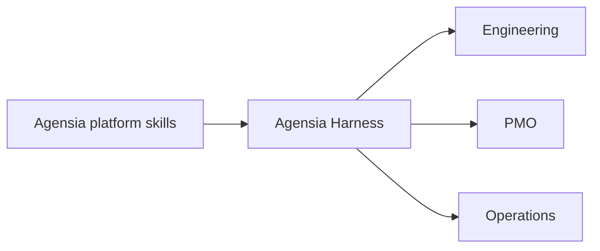

# Agensia Plugins

The skill is now named `make-pod`; the plugin remains `agensia-harness`.

Download installable ZIPs from [GitHub Releases](https://github.com/meorajrul/agensia-plugins/releases/latest). ZIP archives are release assets and are not stored in the source tree.

Reference guidance now uses self-contained, company-neutral design checks for coverage, decision risk, reversibility and ownership.

Version **1.1.1** adds generic configuration verification: commit/save/reopen checks, generated Talent and role reconciliation, page-helper evidence provenance, source consistency, honest score interpretation and bounded runtime regression candidates. It separates reusable methods from case facts and observed receipts; no customer data or fixed score guarantee is included.

[Installation guide: ChatGPT Desktop, Claude Desktop and manual ZIP import](docs/INSTALL.md).

Dedicated platform skills for designing governed Agensia Pods and agent harnesses. Bring your own process, approved sources and accountable owner.

## Agensia Harness

[Agensia Harness](plugins/agensia-harness/README.md) turns a business process into a Pod specification, authority controls, ontology packs, Workflow specifications, acceptance cases and an operating handoff. Its G0–G8 design gates preserve explicit human ownership.

**Never create or push changes to Agensia production.** Local drafting is the default; any authorised platform operation requires verified non-production platform and downstream targets. The rule covers tools, connectors and delegated agents. Unknown or mixed targets block dependent operations.

## Use

Start with [the skill](plugins/agensia-harness/skills/make-pod/SKILL.md). Keep its resources together when importing or sharing it. See [portability and exports](docs/PORTABILITY.md), [the catalog](docs/skill-catalog.md) and [maintenance instructions](AGENTS.md).

The plugin is named `agensia-harness` and its skill is `make-pod`; hosts may qualify the invocation as `agensia-harness:make-pod`. The [migration map](docs/skill-name-migration.json) records previous software identifiers. Historical identifiers are not installed aliases. This collection contains only the generic harness skill; no customer evidence or environment configuration is bundled.

<!-- BEGIN BUNDLE CATALOG -->
## Department map

These are intended users of the plugins. PMO means project management; GTM means sales and marketing.

| Plugin | Intended departments | Skills |
|---|---|---|
| [agensia-harness](plugins/agensia-harness/README.md) | Engineering, PMO, Operations | 1 |

**1 plugins · 1 top-level skills.** Nested helper skills are bundled resources, not separate catalog entries.

[Browse every skill](docs/skill-catalog.md) · [Name migration](docs/skill-name-migration.json)

Catalog fingerprint: `ae0fb7f68804b738e4ab3591fe1d577ff3daa1c14b7eac62bfae17f2c51870a9`.
<!-- END BUNDLE CATALOG -->
