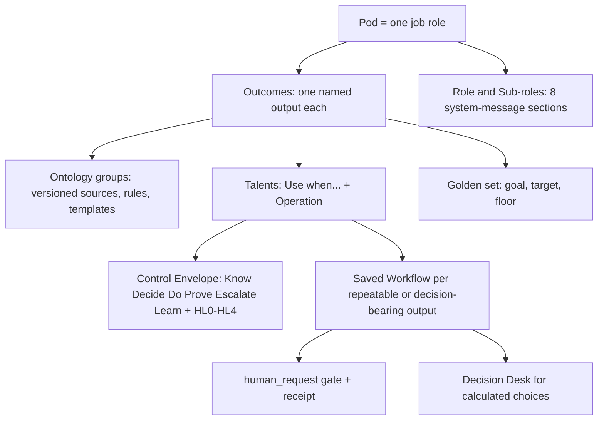
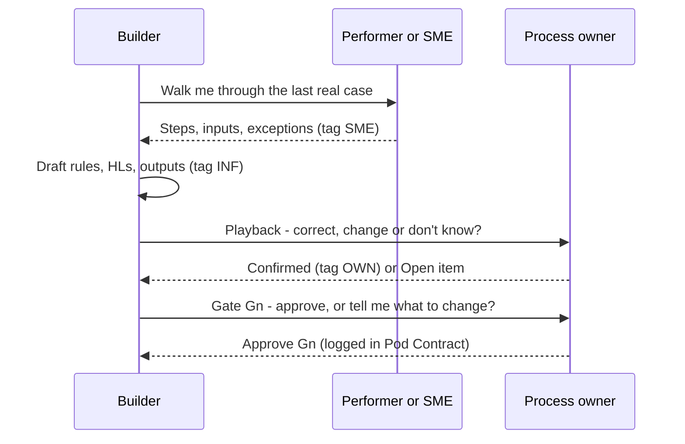
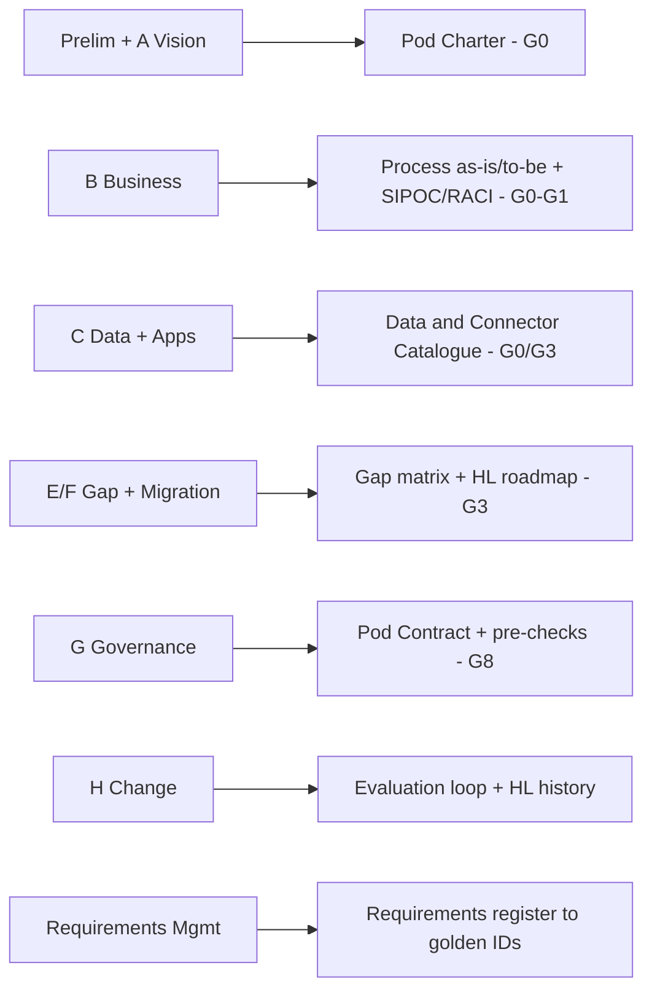

# Agensia Harness

The skill is named `make-pod`; the plugin is `agensia-harness`. Invoke it as `agensia-harness:make-pod`.

**In one line:** turn a business process into a governed Agensia Pod. Every answer is traced to who said it, every agent action has an explicit harness level, and every outcome has a test set. Nothing goes live without a named human approving it.

Download installable ZIPs from [GitHub Releases](https://github.com/meorajrul/agensia-plugins/releases/latest). [Installation guide](../../docs/INSTALL.md).

## Consultant mode

Most Pods are built by someone who is **not** the process owner. The skill supplies what an enterprise-architecture or business-process consultant would bring:

- **[Elicitation cards](skills/make-pod/references/elicitation-cards.md):** for every Agensia component, the question to ask, who must answer it, the evidence that confirms it and the safe default until confirmed.
- **Provenance tags on every fact:** `OWN`, `DOC`, `SME`, `OBS`, `INF` and `ASM`. A gate cannot pass on an inferred or assumed *must* value.
- **[TOGAF crosswalk](skills/make-pod/references/togaf-crosswalk.md)** and templates: Pod Charter, SIPOC + RACI, Data and Connector Catalogue, role binding, and Pod Contract with a playback log.
- **Role-based naming:** approvers and escalation targets are roles; one role-binding source maps them to current holders.
- **[Retrofit review](skills/make-pod/references/retrofit-review.md):** apply these checks to an existing Pod and report gaps before changing it.
- **Process and Pod spec sections:** as-is/to-be baseline, requirements register, gap matrix and HL roadmap.

## How it works — at a glance

```mermaid
flowchart LR
  subgraph IN[Inputs]
    P[Process / SOP]
    S[Approved sources]
    O[Owner and stakeholders]
  end
  subgraph DESIGN[make-pod design gates G0-G8]
    G0[G0 Intake + Charter] --> G1[G1 Identity + RACI]
    G1 --> G2[G2 Outcomes and Talents]
    G2 --> G3[G3 Authority HL]
    G3 --> G4[G4 Escalation + Decision Desk]
    G4 --> G5[G5 Persona and format]
    G5 --> G6[G6 Ontology packs]
    G6 --> G7[G7 Golden set + owner goal]
    G7 --> G8[G8 Emit + Pod Contract]
  end
  subgraph OUT[Outputs]
    SPEC[Pod spec + harness]
    ONT[Ontology upload set]
    GLD[Golden tests]
    WF[Workflow specs]
  end
  IN --> G0
  G8 --> OUT
  OUT --> NP[Authorised non-production build and read-back]
  NP -. never .-> PROD[Production - prohibited]
```

## What a Pod is made of — Agensia components

Chain rule: **Outcome n ↔ Talent n ↔ Sub-role n**, at least one ontology pack per outcome, and one saved Workflow per repeatable output.

## Consultant mode — when you are not the process owner

| Ask this role | For |
|---|---|
| Sponsor | Drivers, business goal, KPI baseline |
| Process owner | Outcomes, rules, HLs, approvers, targets, signature |
| Performer / SME | Steps, inputs, volumes, exceptions, real cases |
| Data / system owner | Systems of record, classification, connector scope |
| Risk / compliance | Binding rules, prohibitions, retention |

## TOGAF crosswalk

## Harness levels

| Level | Agent may | Human |
|---|---|---|
| HL0 Observer | read, summarise, alert | consumes |
| HL1 Advisor | draft, recommend | executes everything |
| HL2 Preparer | prepare complete actions + evidence | approves each action |
| HL3 Bounded executor | reversible in-policy actions | reviews samples |
| HL4 Delegated operator | end-to-end in envelope | owns risk; never for a new Pod |

Irreversible, financial, legal or personal actions are never above HL2.

## Files it produces

| File | Purpose |
|---|---|
| `pod-charter-<slug>.md` | Why: drivers, goals, stakeholders, scope (consultant mode) |
| `process-<apqc>-<slug>.md` + `sipoc-raci-<slug>.md` | How the work runs today and who decides |
| `pod-<role>-<subrole>.md` | The Pod spec and paste-ready platform fields |
| `harness-<slug>.md` | Control Envelope and control verification |
| `data-connector-<slug>.md` | Data objects, connectors, environments |
| `ontology-<outcome>.md` | Knowledge pack per outcome + flat upload set |
| `goldens-<outcome>.md` | Signed goal + test cases per outcome |
| `role-binding-<slug>.md` | Role → current holder and cover (uploaded as a source) |
| `pod-contract-<slug>.md` | Playback log and signed design agreement |

## Strict production prohibition

**Agensia Harness must never create or push changes to Agensia production.** This includes uploads, submissions, publication, edits, deletions, runs, schedules and writes through production-connected integrations. It applies equally to UI actions, APIs, scripts, connectors and delegated agents. Verify non-production status for the platform and downstream resources before operations; unknown targets block operations. No owner request or design-gate approval waives this rule.

Production release is a separate human-controlled process outside this skill. The skill can supply local specifications and non-production test plans; it does not perform production release.

## Core distinctions

- Pods coordinate job-role capabilities; Talents define triggered operations; ontology supplies versioned knowledge, procedures and templates.
- Saved Workflows execute repeatable or decision-bearing tasks. Blueprints plan work, Collections organise saved context, and schedules time authorised work.
- Native calculated decisions require their own inputs, solve, acceptance and return to the originating task.
- Source binding, actual reading, saved configuration, execution, human decision and useful outcome require separate evidence.
- Harness levels define authority; prompt wording and evaluation scores do not enforce it. Consequential actions remain human-controlled.

## References

| Guide | Purpose |
|---|---|
| [Platform guide](skills/make-pod/references/agensia-platform-walkthrough.md) | Components and four-part configuration |
| [Capabilities and acceptance](skills/make-pod/references/platform-knowledge-and-uat.md) | Generic coverage and negative tests |
| [Onboarding verification](skills/make-pod/references/platform-evidence-and-onboarding.md) | Actor/access map and evidence-based handoff |
| [Workflow contract](skills/make-pod/references/workflow-execution-contract.md) | Versioned tasks, bindings, native gates and recovery |
| [Prompt playbook](skills/make-pod/references/converse-prompt-playbook.md) | Templates for authorised non-production operation |
| [Configuration verification](skills/make-pod/references/configuration-verification.md) | Saved-state checks, score-guided changes and runtime evidence |
| [Evaluation](skills/make-pod/references/pod-evaluation.md) | Owner goals, paired comparison and regression gates |

## Use and verification

Use the host's available tools and the recipient's approved sources. Read applicable local instructions. No installation, account connection or permission follows from importing this package. Reference guidance uses company-neutral design checks.

The package provides self-contained generic guidance, a non-waivable production boundary and synthetic refusal scenarios. Test cases start unrun; static package validation is not runtime certification. Intended departments: Engineering, PMO and Operations.

The plugin is named `agensia-harness` and its skill is `make-pod`. The P2A method, resources and production prohibition are preserved under this name.

<!-- BEGIN SKILL CATALOG -->
## Departments and portable skills

**Intended departments:** Engineering, PMO, Operations.

**1 skills.** [Full catalog](../../docs/skill-catalog.md) · [Cross-platform setup](../../docs/PORTABILITY.md).

Skill paths and names below are the current invocation identifiers. Previous names are recorded in the [migration map](../../docs/skill-name-migration.json).

| Skill | Intended departments |
|---|---|
| [make-pod](skills/make-pod/SKILL.md) | Engineering, PMO, Operations |

Catalog fingerprint: `a257b59959a8bae8f33cab87ca294b9c24aff919ea6443fe106fe9da6df56d8a`.
<!-- END SKILL CATALOG -->
