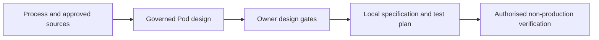

# Agensia Harness

The skill is now named `make-pod`; the plugin remains `agensia-harness`.

Download installable ZIPs from [GitHub Releases](https://github.com/meorajrul/agensia-plugins/releases/latest). ZIP archives are release assets and are not stored in the source tree.

Reference guidance now uses self-contained, company-neutral design checks for coverage, decision risk, reversibility and ownership.

Version **1.1.1** adds generic configuration verification: commit/save/reopen checks, generated Talent and role reconciliation, page-helper evidence provenance, source consistency, honest score interpretation and bounded runtime regression candidates. It separates reusable methods from case facts and observed receipts; no customer data or fixed score guarantee is included.

[Installation guide: ChatGPT Desktop, Claude Desktop and manual ZIP import](../../docs/INSTALL.md).

Design governed AI Pods from business processes, approved sources and explicit human responsibilities. P2A connects **Outcome, Context, Sources, Scope, Authority, Output and Verification** through nine design gates, G0–G8.

## Agensia Harness

Start with [the skill](skills/make-pod/SKILL.md). Supply a process/SOP, intended users and outputs, approved knowledge, systems and accountable owner. A partial brief is enough to begin a labelled draft; missing facts remain open.

The skill produces a Pod specification, harness/control specification, ontology packs, per-outcome golden tests, platform field mapping and operating handoff. Local drafting is the default. No private reference library, environment URL or particular workspace folder structure is required. Keep the whole skill folder together when sharing it.

## Strict production prohibition

**Agensia Harness must never create or push changes to Agensia production.** This includes uploads, submissions, publication, edits, deletions, runs, schedules and writes through production-connected integrations. It applies equally to UI actions, APIs, scripts, connectors and delegated agents. Verify non-production status for the platform and downstream resources before operations; unknown targets block operations. No owner request or design-gate approval waives this rule.

Production release is a separate human-controlled process outside this skill. The skill can supply local specifications and non-production test plans; it does not perform production release.

## Core distinctions

- Pods coordinate job-role capabilities; Talents define triggered operations; ontology supplies versioned knowledge, procedures and templates.
- Saved Workflows execute repeatable or decision-bearing tasks. Blueprints plan work, Collections organise saved context, and schedules time authorised work.
- Native calculated decisions require their own inputs, solve, acceptance and return to the originating task.
- Source binding, actual reading, saved configuration, execution, human decision and useful outcome require separate evidence.
- Harness levels define authority; prompt wording and evaluation scores do not enforce it. Consequential actions remain human-controlled.

## References

| Guide | Purpose |
|---|---|
| [Platform guide](skills/make-pod/references/agensia-platform-walkthrough.md) | Components and four-part configuration |
| [Capabilities and acceptance](skills/make-pod/references/platform-knowledge-and-uat.md) | Generic coverage and negative tests |
| [Onboarding verification](skills/make-pod/references/platform-evidence-and-onboarding.md) | Actor/access map and evidence-based handoff |
| [Workflow contract](skills/make-pod/references/workflow-execution-contract.md) | Versioned tasks, bindings, native gates and recovery |
| [Prompt playbook](skills/make-pod/references/converse-prompt-playbook.md) | Templates for authorised non-production operation |
| [Configuration verification](skills/make-pod/references/configuration-verification.md) | Saved-state checks, score-guided changes and runtime evidence |
| [Evaluation](skills/make-pod/references/pod-evaluation.md) | Owner goals, paired comparison and regression gates |

## Use and verification

Use the host's available tools and the recipient's approved sources. Read applicable local instructions. No installation, account connection or permission follows from importing this package. Reference guidance uses company-neutral design checks.

Version **1.0.0** provides self-contained generic guidance, a non-waivable production boundary and synthetic refusal scenarios. Test cases start unrun; static package validation is not runtime certification. Intended departments: Engineering, PMO and Operations.

The plugin is named `agensia-harness` and its skill is `make-pod`. The P2A method, resources and production prohibition are preserved under this name.

<!-- BEGIN SKILL CATALOG -->
## Departments and portable skills

**Intended departments:** Engineering, PMO, Operations.

**1 skills.** [Full catalog](../../docs/skill-catalog.md) · [Cross-platform setup](../../docs/PORTABILITY.md).

Skill paths and names below are the current invocation identifiers. Previous names are recorded in the [migration map](../../docs/skill-name-migration.json).

| Skill | Intended departments |
|---|---|
| [make-pod](skills/make-pod/SKILL.md) | Engineering, PMO, Operations |

Catalog fingerprint: `ae0fb7f68804b738e4ab3591fe1d577ff3daa1c14b7eac62bfae17f2c51870a9`.
<!-- END SKILL CATALOG -->
